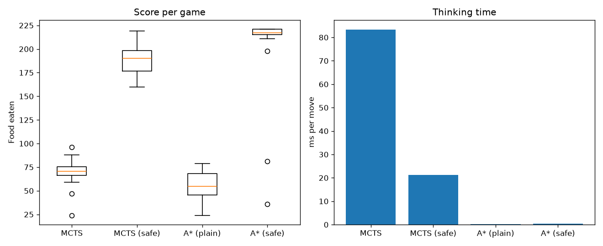

# Snake MC

## Playing Snake with Monte Carlo Tree Search and A*



## Acknowledgements
This project uses the `snake-ai` environment for the snake game from [linyiLYi](https://github.com/linyiLYi/snake-ai). A big thank you to the original author for providing such a great resource.

Author : Po Kai Su

### Introduction
The snake is controlled by a search algorithm instead of a human, and we compare two of them:

- **Monte Carlo Tree Search (MCTS)** – before every move, simulate many possible futures (including where food might appear) and pick the move that leads to the best outcomes on average.
- **A\* search** – plan the shortest path to the food and follow it.

Each comes in a plain and a **safe** variant. Safe mode adds one rule: never make a move after which the snake's head can no longer reach its own tail.

This project grew out of our earlier final project, where the snake was controlled by body posture captured with a webcam (Mediapipe + an MLP classifier). Here the webcam is replaced by search algorithms.

### Project structure
| File | Description |
| --- | --- |
| [snake_game.py](snake_game.py) | The game (pygame) and the entry point for watching an agent play |
| [mcts.py](mcts.py) | Monte Carlo Tree Search agent (plain and safe), plus the fast game simulator it uses |
| [astar.py](astar.py) | A\* agent, plain and safe variants |
| [compare.py](compare.py) | Runs every agent on the same games and prints a results table |
| `image/`, `sound/` | Game graphics and sound effects |

### How MCTS chooses a move
Each move, the agent ([mcts.py](mcts.py)) repeats four phases (300 times by default, or until the time limit):

1. **Selection** – start at the current position and walk down the search tree, choosing moves with the UCT formula, which balances moves that have scored well (exploitation) against moves that have been tried rarely (exploration).
2. **Expansion** – add one move that has not been tried yet to the tree.
3. **Simulation (rollout)** – play ahead up to 30 steps with a fast policy: head toward the food while avoiding moves that die immediately, with some randomness.
4. **Backpropagation** – add the result to every node on the path.

The move whose node was visited most is played.

Rewards: +1 for eating food, −1 for dying, discounted by 0.97 per step. If a rollout ends with the snake still alive, the position is scored by how close the head is to the food, and penalised if a flood fill shows the snake has trapped itself in a space smaller than its own length.

Food appears at random, so the tree is *open-loop*: each node keeps statistics for a sequence of moves, and every iteration replays that sequence with newly sampled food.

**MCTS (safe)** adds the tail rule from safe A\* in two places:
1. **Before searching**, it removes every move after which the head can no longer reach the tail (if at least one move is left), so the tree only explores safe first moves. If only one safe move remains, it is played without searching.
2. **When a rollout ends**, the position is penalised if the head cannot reach the tail. This replaces the flood-fill check, which only counts free cells and can miss traps.

### How A* chooses a move
The A\* agent ([astar.py](astar.py)) finds the shortest path from the head to the food, with cost = steps taken and heuristic = Manhattan distance. The search is time-aware: the body segment `k` cells behind the head leaves its cell after `len(snake) - k` steps, so a path may go through cells the tail will have vacated by the time the head gets there.

- **A\* (plain)** follows that path. If there is no path, it moves to the neighbouring cell with the most free space reachable from it.
- **A\* (safe)** first imagines the snake after following the path and eating. It follows the path only if, from there, the head can still reach the tail, because a snake that can reach its tail can always escape by following it. Otherwise it stalls: it takes a move that keeps the tail reachable, as far from the food as possible, until eating becomes safe.

### Installation
Requires Python 3.10 or newer.
```bash
git clone https://github.com/winston98321/snake_MC.git
```
```bash
cd snake_MC
```
```bash
pip install -r requirements.txt
```

### Usage
Watch an agent play (click **START THE GAME**):
```bash
python snake_game.py --agent mcts
```
```bash
python snake_game.py --agent mcts-safe
```
```bash
python snake_game.py --agent astar-safe
```

Run games without a window and print the scores:
```bash
python snake_game.py --headless --games 5
```

Compare the agents on the same games (game `i` uses seed `i` for every agent):
```bash
python compare.py --games 20 --csv results.csv --plot compare.png
```

| Option | Default | Description |
| --- | --- | --- |
| `--agent` | mcts | `mcts`, `mcts-safe`, `astar` or `astar-safe` |
| `--iterations` | 300 | MCTS iterations per move |
| `--time-limit` | 0.2 | Max thinking time per move in seconds (0 = no limit) |
| `--rollout-depth` | 30 | Steps simulated in each rollout |
| `--interval` | 0.1 | Minimum seconds between snake moves |
| `--board-size` | 15 | Board width and height |
| `--seed` | random | Random seed |

### Results
20 games per agent on the 15×15 board, seeds 0–19 (`python compare.py --games 20`). Both MCTS agents used 300 iterations per move with no time limit. The highest possible score is 222: the board has 225 cells and the snake starts 3 long.

| Agent | Avg score | Std | Min | Max | Avg steps | ms/move | Died | Stopped (looping) |
| --- | --- | --- | --- | --- | --- | --- | --- | --- |
| MCTS | 69.8 | 15.1 | 24 | 96 | 1211 | 83.33 | 20 | 0 |
| MCTS (safe) | 188.1 | 16.3 | 160 | 219 | 8559 | 21.33 | 2 | 18 |
| A\* (plain) | 55.5 | 15.3 | 24 | 79 | 694 | 0.12 | 20 | 0 |
| A\* (safe) | 201.4 | 49.7 | 36 | 221 | 8444 | 0.40 | 2 | 18 |

"Stopped (looping)" means the snake was still alive but went 900 steps without eating, so the game was ended. This happened to the safe agents when they could find no safe way to the food, usually late in the game with the board mostly full: at scores of 161–219 for MCTS (safe), and 211–221 for A\* (safe) except one game that got stuck at 81. Times per move were measured with games running in parallel, so they are higher than for a single game on its own.

**What we found**
- **Plain A\* is fast but short-sighted.** It always takes the shortest path, so it soon closes off parts of the board with its own body and traps itself.
- **Plain MCTS beats plain A\*** (70 vs 56 on average) because its simulations can see some traps coming. But it looks only about 30 steps ahead and only gets 300 simulations per move, so once the snake is long, a trap often closes beyond that horizon. It is also hundreds of times slower per move.
- **The tail rule is the biggest improvement for both methods.** "Can I still reach my tail?" is an exact safety check for this game, and much stronger than what a 30-step rollout can estimate. It raised MCTS from 70 to 188 and A\* from 56 to 201.
- **Safe MCTS is also 4× faster than plain MCTS**, because it skips the search whenever only one safe move is left, and its rollouts no longer waste time on moves that lead into traps.
- **Safe A\* has the higher average and best games; safe MCTS is more consistent.** Safe MCTS never scored below 160 (standard deviation 16), while safe A\* died once at 36 and got stuck once at 81 (standard deviation 50). Safe A\* always takes the shortest path, so it once followed a one-cell-wide corridor where new food then appeared; it had to eat it, grew by one and hit a dead end. MCTS simulates where new food may appear, so it is less likely to walk into such a corridor. But its rollouts head for the food greedily, so it fills the board less neatly and gets stuck stalling earlier.
- **Takeaway:** the hand-written tail rule matters more than the choice of search. With it, A\* is best for raw score and speed, and MCTS is best for reliability. Possible next steps for MCTS: more iterations, or using the tail rule inside the rollouts as well.
